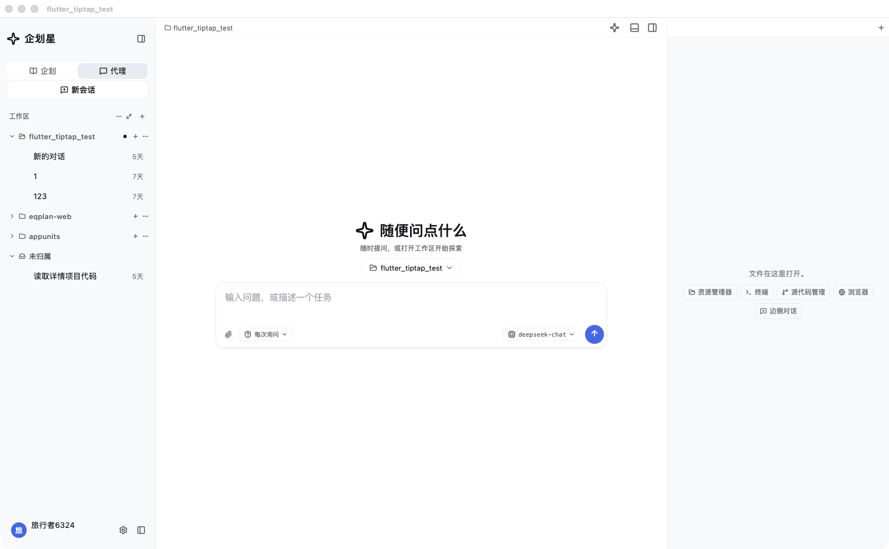
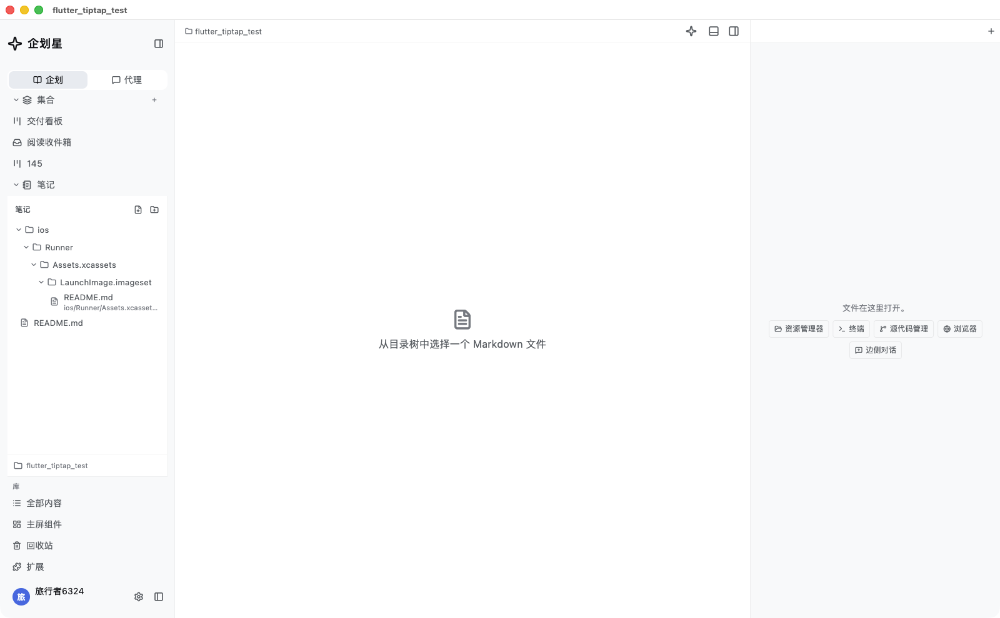
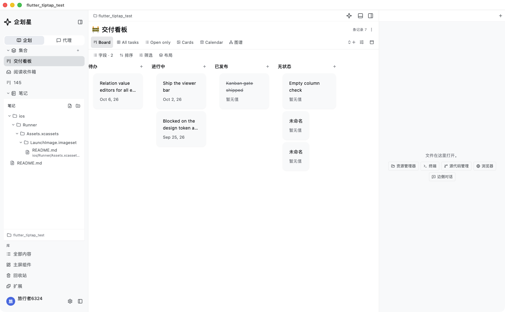
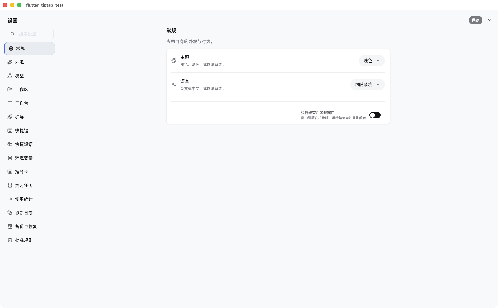
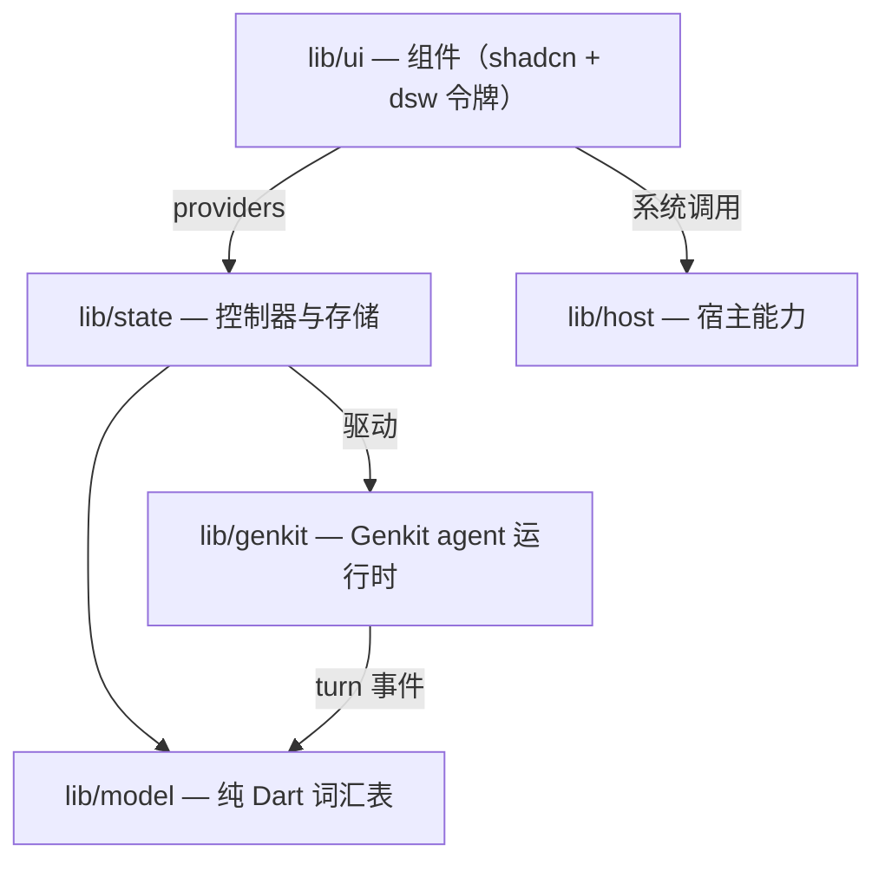

<div align="center">

# 企划星 · PlanStar

**用 Flutter + Google Genkit 从零实现的桌面端 AI Agent 工作台。**

一个外壳，两种工作区模式，随时在侧栏切换——

- **代理模式**：一个能读、写、运行你项目代码的 AI Agent；
- **企划模式**：把本地 Markdown 复刻成 Notion / Anytype 风格的数据视图内核。

自带模型密钥（BYOK）；除了你主动发起的那次 API 调用，任何数据都不离开本机。

*macOS · Windows · Linux · Flutter 3.41 · Dart 3.11 · Genkit 0.16*

</div>

> 英文文档见 [README.md](README.md)。

---

## 界面一览

| 代理模式 —— 基于 Genkit 运行时的对话，工作区在侧栏分组 |
| --- |
|  |

| 企划模式 —— 本地 Markdown 库，侧栏是可折叠的「集合 / 笔记」树 |
| --- |
|  |

| 数据视图 —— 同一份记录投影为 看板 / 表格 / 列表 / 画廊 / 日历 |
| --- |
|  |

| 设置中心 —— 15 个分区：外观、模型、工作区、工作台、MCP、快捷键、用量、备份、批准规则…… |
| --- |
|  |

---

## 这是什么？

PlanStar 是一个**原生桌面应用**——不是网页套壳，也不是 Electron 应用。在这里，
一个 AI 编码 Agent 和一个个人知识工作台并肩生活在同一个窗口里，靠侧栏在两种模式
之间切换：

- **代理（Agent）** —— 建立在进程内 [Google Genkit](https://genkit.dev)（Dart）
  运行时之上的对话界面，配有真实的工具调用环和一个用于操作文件的分栏工作台。
- **企划（Plan）** —— 一个本地 Markdown 工作台，复刻 [Anytype](https://anytype.io)
  的数据视图内核：记录是 `Struct` 的视图，同一份记录可渲染为 表格 / 列表 / 画廊 /
  看板 / 日历，背后是一套对象库和一个块编辑器。

Agent 运行时和企划工作台共享同一个"工作区"（磁盘上的一个文件夹）概念，但除此之外
彼此独立——你可以只用其中一种。

---

## 代理模式

Agent 做的每一件事都被投影成可查看、可回退的事件——绝无静默的文件改动。

- **工具调用投影** —— 每次 `read` / `write` / `edit` / `glob` / `grep` / `bash`
  都渲染成一张卡片，带参数、结果与 diff。
- **审批门禁** —— 按工作区配置 Agent 哪些操作可以先问、哪些免问（每次询问 /
  只读自动放行 / 自定义规则）。
- **输入排队与中途转向** —— Agent 忙时照样可以打字；排队的输入和中途引导会在下一个
  安全时机注入。
- **文件检查点 + 回退** —— 任何覆盖写之前都会留存"改动前"镜像，于是每张工具卡上都有
  一枚一键回退的 pill。
- **MCP 服务器** —— 在设置里接入外部 Model Context Protocol 工具。
- **子 Agent 与边侧对话** —— 把活儿委托给一个 `general-purpose` 子 Agent，或开一路
  不污染主线的边侧对话。
- **分栏工作台** —— 文件树、代码编辑器、集成终端（`flutter_pty` + `xterm`）、
  git 面板、diff 查看器、内置浏览器、边侧对话，排成可拖拽的分栏布局，按工作区持久化。
- **`@` 引用** —— 一份 BFS 文件索引让你在输入框里引用项目文件，发送时展开成上下文。
- **会话分组** —— 对话历史按工作区分组，支持置顶、改名与墓碑删除。

## 企划模式

一件严肃的本地知识工具，把 Markdown 当作盘上的唯一事实来源。

- **一份记录，五种投影** —— 表格 / 列表 / 画廊 / 看板 / 日历都读自同一个存储；
  筛选 / 排序 / 分组 / 限制由一套共享引擎负责。
- **块编辑器** —— 基于 `re_editor` 的实时样式编辑（`packages/plan_editor`），
  支持 toggle、标注块、引用、代码、表格与行内样式。
- **对象库** —— 全部内容、对象信息、新建集合、模板、日期、画廊，外加一个回收站
  （软删除的记录）。
- **库树（vault tree）** —— 工作区里的 `.md` 文件以可折叠的资源管理器形态住在侧栏；
  塞不进 Markdown 的块走一行 `<!-- plan:{json} -->` 信封往返。
- **看板与日历** —— 支持拖拽换列的看板，以及日历月视图，由入库的
  `packages/board_panel` 提供。

---

## 技术栈

| 层 | 选型 |
| --- | --- |
| 框架 | Flutter 3.41 / Dart 3.11 |
| Agent 运行时 | Google Genkit 0.16（+ `genkit_openai` / `_anthropic` / `_google_genai` / `_mcp` / `_middleware`） |
| 状态管理 | `flutter_riverpod` 3.2（注解模式） |
| 组件库 | `shadcn_ui` 0.56 + 一层 `dsw_*` 设计令牌主题 |
| 持久化 | `drift` 2.31（单库多域 SQLite）+ 原子写 JSON 存储 |
| 编辑器 | `re_editor` + `gpt_markdown`（LaTeX + Mermaid 围栏图） |
| 终端 / 浏览器 | `flutter_pty` + `xterm`，`flutter_inappwebview` |
| 密钥 | `flutter_secure_storage` —— 系统钥匙串（Keychain / DPAPI / libsecret） |
| 本地包 | `packages/` 三层 monorepo，由 `lib` 向下消费 —— `board_panel`（数据视图）、`plan_editor`（块编辑器）、`app_common`（反馈 + 应用内升级）；ADR-0083 / ADR-0084 |
| 本地化 | `flutter gen-l10n`，ARB 为盘上唯一源（中英双语）；`app_common` 自带一份生成的语言束（`AppCommonLocalizations`） |

### 架构总览

严格分层——UI 经控制器读取，控制器驱动 Genkit 运行时，两侧共用一份纯 Dart 词汇表（`model/`）。运行时永不触碰 Flutter，组件永不直接调用 `dart:io`（一律经 `host/`）。



### 架构不变量

分层不是靠约定，而是靠一道可执行的门禁来守：

```sh
dart tool/check_architecture.dart   # 8 条规则，指纹 baseline，只拦新增
```

- `package:genkit` 只允许在 `lib/genkit/` 内被导入。
- `lib/model/` 永不导入 Flutter——它是运行时与 UI 之间的纯 Dart 词汇表。
- 运行时不许伸进 `lib/state/`，也不许碰 `dart:ui`。
- `lib/ui/` 不直接调用 `dart:io`（一律经 `lib/host/`）。

### 本地包与 monorepo

`packages/` 是三层 monorepo，依赖路线**单向**（ADR-0083 / ADR-0084）：


`lib/` 是唯一消费者——没有任何包可以 import `lib`。入库包中被 path 依赖接进 `lib`
且真正用到的有三个：**`board_panel`**（企划看板与日历）、**`plan_editor`**（样式化
Markdown 块编辑器）、**`app_common`**（宿主无关的反馈表单 + 应用内升级面板，界面文案
住在包自带的 gen-l10n 束里）。其余（`appunits_core`、`stone_core`、`pudding`）是
vendored / parked 状态，**刻意不被 lib 消费**——逐个理由见 ADR-0084 的复用边界映射。

---

## 安全与隐私

- **自带密钥（BYOK）。** 服务商 API 密钥存放在系统钥匙串里，落盘前会从设置文件中
  剥离——明文密钥永不进磁盘，也永不进 git。
- **本地优先。** 企划数据就是工作区里的普通 Markdown；Agent 只在你已授权的文件夹内操作。
- **动作可查。** 每一次工具调用与文件写入都可见、可回退。

---

## 平台支持

三个桌面目标是一等公民：**macOS**、**Windows**、**Linux**。
`android/` 与 `ios/` 只是品牌脚手架——应用面向桌面，无法在移动端运行
（启动即撞上未注册的桌面插件）。

---

## 构建与测试

```sh
flutter pub get                                  # 新机器第一步
dart format --set-exit-if-changed lib test tool spike
dart analyze --fatal-infos lib test tool spike
flutter test                                     # 127 个测试文件
dart tool/check_architecture.dart                # 架构门禁
dart tool/contrast_check.dart                    # 主题令牌 WCAG 对比度

flutter build macos --release                    # 需 macOS + Xcode + CocoaPods
flutter build windows --release                  # 需 VS C++ 桌面负载 + CMake
flutter build linux --release                    # 需 GTK 工具链
```

`pubspec.yaml` 是唯一版本事实；三次门禁通过后从 `develop` 打标签发版。

---

## 文档

- [`AGENTS.md`](AGENTS.md) —— AI 编码代理入口；规则与约定索引。
- [`docs/README.md`](docs/README.md) —— ADR 体系（分类、优先级、状态机）。
- [`docs/debt-register.md`](docs/debt-register.md) —— 已知问题与技术债的唯一状态源。
- [`docs/adr/`](docs/adr/) —— 架构决策记录（ADR），记录每一个设计取舍（最新为 ADR-0084）。
- [`docs/production-readiness-gap-2026-10-02.md`](docs/production-readiness-gap-2026-10-02.md) —— 商用化差距盘点。

---

## 状态

早期生产阶段——版本 `0.1.0`，ad-hoc 签名，积极开发中。核心 Agent 环、工作台与企划
数据视图内核已可用并被测试覆盖；分发签名/公证与自建后端仍作为待办项跟踪。

## 许可证

本项目以 **GNU 通用公共许可证 v3.0 或更高版本（GPL-3.0-or-later）** 发布——完整条款见 [`LICENSE`](LICENSE)。

你可以自由使用、研究、分享和修改本软件；但你对外分发的衍生作品必须以相同许可证开源并公开其源码。
